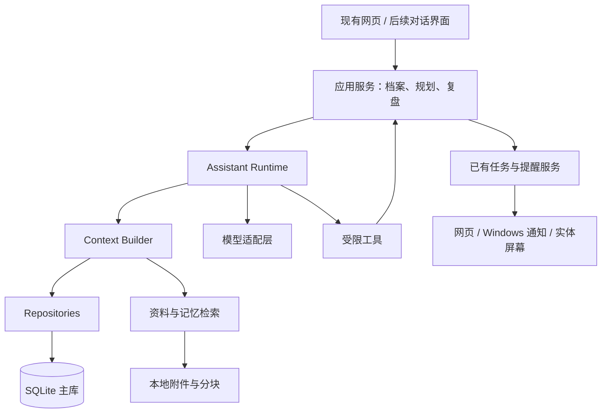

# 个人助理架构规划

状态：持续演进的规划，2026-11-18。当前已落地统一存储入口与资料库；档案、模型运行与上下文装配仍待实施。

## 目标与当前基线

个人助理需要结合用户背景、人生阶段、能力证据、目标与近期执行情况，提供学习、求职和方向建议；用户确认后把建议写成任务，随后提醒和复盘。

当前代码支持网页计划、提醒、实体桌历、个人档案和分类资料库。正式 schema v5，共 10 张业务表。语音日记与文字助理的运行方式见 [使用说明](../COMPANION.md)。

本规划的默认选择：单机单用户、Python 模块化应用、一个 SQLite 主库、附件文件存储、可替换的模型接口。保持已有网页与固件可用。暂不拆微服务，不要求 Redis、独立向量数据库或多 Agent。

## 阅读顺序

1. [开发目录与模块边界](DIRECTORY.md)：代码应放在哪里、如何逐步拆分现有模块。
2. [数据存储设计](STORAGE.md)：事实、历史、附件、模型运行与计划草稿的关系。
3. [上下文管理](CONTEXT.md)：每次模型调用如何选取、压缩、引用与更新信息。
4. [实施顺序与验收](IMPLEMENTATION.md)：分阶段交付和迁移规则。
5. [SQL 结构草案](proposed_v2.sql)：在临时 v1 数据库上检查的增量 DDL，尚未作为正式迁移启用。

## 模块关系

## 核心约定

- SQLite 是业务记录的权威来源；导出的个人 Markdown、摘要和检索索引是派生数据。
- 真实聊天、个人档案、导入资料、上下文清单和备份均属于私有运行数据。
- 手动记忆本继续有效；模型提取的个人事实先存候选，确认后参与稳定画像。
- 模型解释和建议可追溯到来源；模型推测不自动升级为能力结论或人生目标。
- 提醒计时沿用确定性代码；模型请求修改任务时，通过应用服务生成可审阅草稿。
- 短期上下文按对话隔离，长期记忆跨对话按相关性检索。应用会话 ID 独立于 Codex/模型供应商会话 ID。
- 只为已实现的能力声明完成；本规划中的新增能力均待开发。
